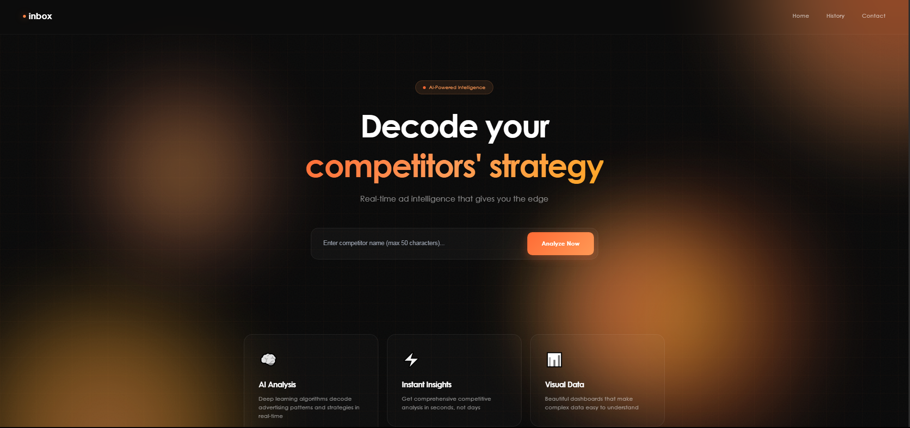
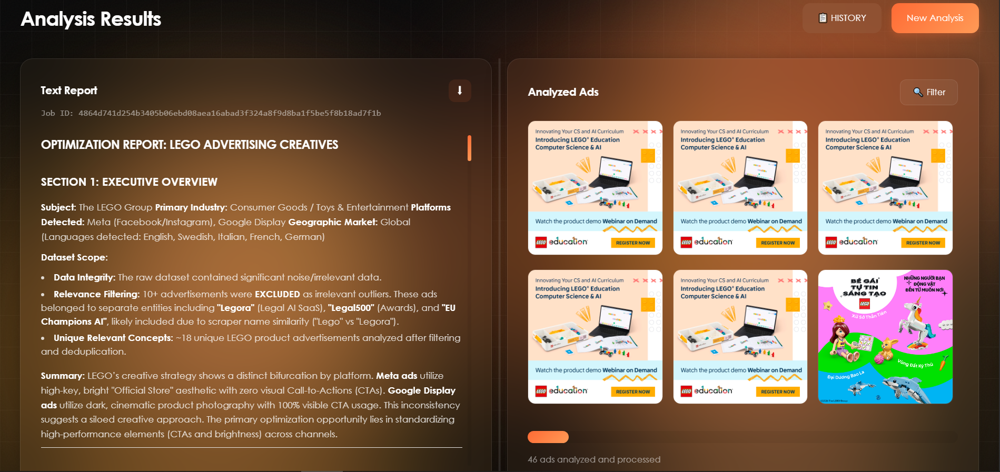
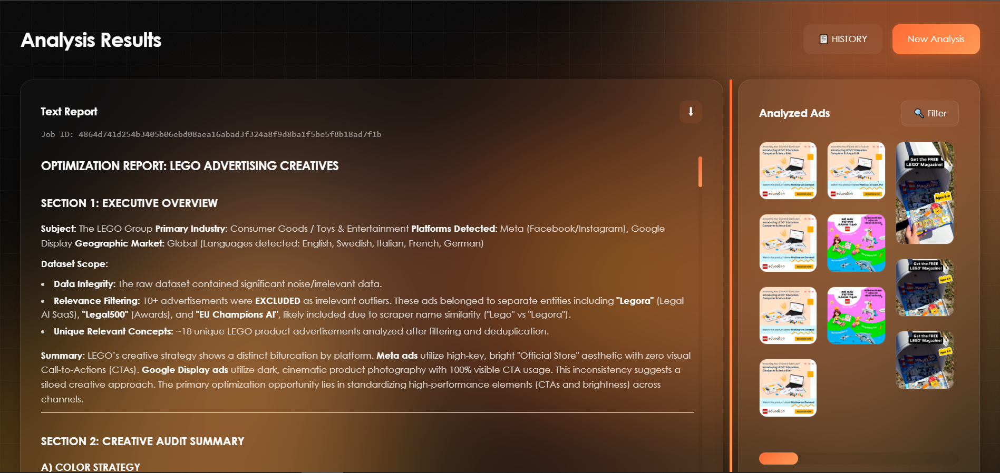
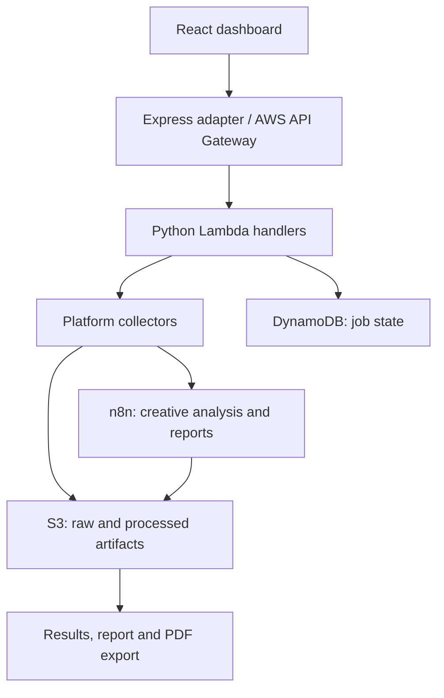

# AdSpy Intelligence

> Competitive advertising intelligence — collect competitor ads and turn their text and creative assets into an AI-assisted analysis report.

Developed by a **four-person team** for **Inbox Communications Inc.** This repository presents the project, its architecture, and sample outputs from the scraping stage.

---

## What is AdSpy?

AdSpy brings advertising collection, creative preparation, and analysis into one workflow. A user enters a company name or domain, the backend collects advertising data across supported platforms, and analysis workflows produce a report that can be viewed and exported from the dashboard.

The integrated collector supports Meta, LinkedIn, Google, and Reddit through ScrapeCreators integrations. The included historical samples document LinkedIn, Google, and Meta responses.

## Key features

- **Multi-platform collection:** retrieve advertising records from supported ad-library data sources.
- **Creative preparation:** extract text fields, download images, and combine or resize creatives for analysis.
- **AI-assisted reports:** n8n workflows coordinate image analysis and report generation.
- **Progress tracking:** follow scraping and report status from the web interface.
- **Results gallery:** browse collected creative assets alongside the generated report.
- **PDF export:** export the report from the browser.
- **Job history:** retrieve previous analyses using a job ID.

## Usage flow

### 1. Search — enter a competitor



### 2. Results — browse collected creatives



### 3. Report — review the analysis



These screenshots show the shared team application. Screenshot sources are recorded in [project provenance](docs/ATTRIBUTION.md).

## Architecture



The scraper prepares queries, collects platform responses, and saves raw JSON separately from selected text and processed images. n8n consumes those artifacts for downstream analysis. The application retrieves results through backend endpoints and presigned URLs.

## Tech stack

| Layer | Technology |
|---|---|
| Frontend | React, TypeScript, Vite |
| UI and styling | Tailwind CSS, shadcn/ui, Radix UI, Framer Motion |
| Data and forms | TanStack React Query, React Hook Form, Zod |
| Collection | Python, Requests, ScrapeCreators integrations |
| Image processing | Pillow, concurrent download workers |
| Backend | Express, AWS Lambda, API Gateway |
| Storage and state | S3, DynamoDB |
| Analysis | n8n and LLM integrations |
| PDF export | jsPDF, html2canvas |
| Testing | Vitest, Playwright, Python API tests |

## Scraping samples

| Platform | Sample | Records included | Main fields |
|---|---|---:|---|
| LinkedIn | [linkedin_sample.txt](docs/samples/linkedin_sample.txt) | 13 | Advertiser, format, headline, CTA, media reference |
| Google | [google_sample.txt](docs/samples/google_sample.txt) | 40 | Advertiser/creative IDs, domain, format, visibility dates |
| Meta | [meta_sample.txt](docs/samples/meta_sample.txt) | 22 | Snapshot text, image/card arrays, publisher platforms |

These files are historical outputs, not live inventories. Media links can expire, and absent fields remain absent. Meta reports 4,206 search results, but only 22 records are present in the supplied file.

The [scraping walkthrough](docs/SCRAPING.md) explains Iliass Benkirane's scraping contribution, the differences between platform schemas, and how the samples relate to the integrated implementation. It also documents limitations such as Google's listing/detail distinction and pagination handling.

## Setup and run

1. Install a supported Node.js release compatible with the project dependencies.
2. Configure your AWS backend and n8n workflows. This source repository does not provision them.
3. Copy `.env.example` to `.env` and set the deployed jobs API base URL:

```dotenv
VITE_LAMBDA_API_URL=https://YOUR-API.example.com/jobs
```

4. From the repository root, install dependencies and start the web application:

```bash
npm ci
npm run dev
```

End-to-end operation also needs the Lambda handlers, API Gateway routes, DynamoDB tables, S3 bucket, and ScrapeCreators API keys. Replace placeholders and reconnect credentials after importing the sanitized n8n workflow exports. See [scraping configuration](docs/SCRAPING.md#configuration-and-limits).

## Data organization

```text
DynamoDB              Company and job state
S3 raw/json/          Original platform responses
S3 raw/images/        Downloaded creative assets
S3 preprocessed/json/ Selected text fields
S3 preprocessed/images/ Combined/resized creatives
S3 reports/           Generated reports
```

## Documentation and checks

- [Scraping walkthrough and contribution](docs/SCRAPING.md)
- [Historical sample files and single-record excerpts](docs/samples/)
- [Project provenance and screenshot sources](docs/ATTRIBUTION.md)

Existing project checks:

```bash
npm run check
npm run build
npm run test:unit -- --run
npm run test:integration -- --run
```

Python API tests and Playwright scenarios are included as well. Some checks require dependencies or configured external services; the sample files can be inspected offline.
