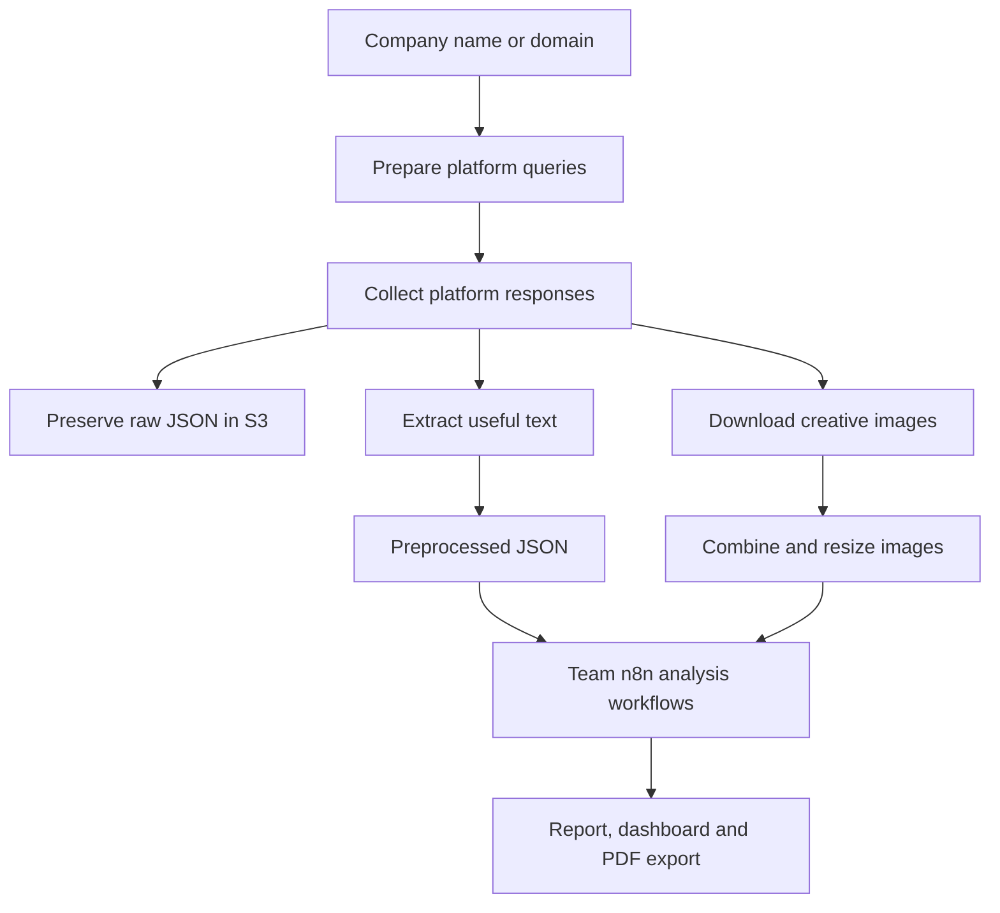

# Scraping contribution — Iliass Benkirane

My contribution to AdSpy focused on collecting advertising data and working with platform-specific response structures for LinkedIn, Google, and Meta. The samples show advertiser identity, ad text, creative references, formats, dates, and pagination metadata at the collection stage. This walkthrough connects those outputs to the integrated project.

The complete application is a team project. Its scraper also supports Reddit; the three samples supplied for this portfolio document LinkedIn, Google, and Meta. The screenshots show the team's complete product, rather than separate interfaces built for this contribution. Descriptions of shared implementation below do not claim authorship of every helper or deployment component.

## Why the collection layer matters

Each platform represents an advertisement differently. LinkedIn has a relatively flat record, Google separates listing metadata from creative details, and Meta nests much of its content inside snapshots and carousel cards. Collection must identify records, preserve source context, select useful text, and locate images before downstream analysis can use them.

The project calls ScrapeCreators endpoints from Python using environment-provided API keys. These are third-party ad-library data integrations, rather than each platform's official advertising API.

## Included evidence

| Platform | Original sample | Records | Response structure |
|---|---|---:|---|
| LinkedIn | [linkedin_sample.txt](samples/linkedin_sample.txt) | 13 | `ads`, `paginationToken`, `isLastPage` |
| Google | [google_sample.txt](samples/google_sample.txt) | 40 | `ads`, `cursor`, `success`, `statusCode` |
| Meta | [meta_sample.txt](samples/meta_sample.txt) | 22 | `results`, `searchResultsCount`, `cursor` |

These are historical response samples, not current inventories or performance benchmarks. Media links may expire. Pagination cursors are response metadata, not API keys. The Meta response reports 4,206 search results, but only 22 records are included in this file; a reported total is different from the number collected.

## LinkedIn: flat records and optional fields

The sample contains Home Depot carousel and video ads. Records include `id`, `advertiser`, `adType`, `poster`, source `url`, `image`, `headline`, `cta`, `description`, and `date`.

The first record identifies carousel ad `676232834`. It has a headline and image URL, while CTA, description, and date are null. Other records have empty headlines or no image. Missing content should stay missing rather than being invented or interpreted as a failed collection.

In [APIs/scrape.py](../APIs/scrape.py), `scrape_linkedin()` handles collection, `_extract_useful_fields_linkedin()` selects advertiser, headline, description, ad type, and CTA, and `_extract_image_urls_linkedin()` reads the image and any carousel image list. `paginationToken` and `isLastPage` represent the response's pagination contract.

[Inspect the first LinkedIn record](samples/linkedin_excerpt.json).

## Google: discover ads, then enrich creatives

The 40 listing records include text and image formats, advertiser and creative IDs, advertiser names, domains, source URLs, and first/last shown dates. Both U.S. and Mexican Home Depot advertisers appear, showing why advertiser identity and domain matter when interpreting a company search.

The first listing has metadata but no headline or description. The integrated `scrape_google()` makes a second request to the creative-detail endpoint for variations. `_extract_useful_fields_google()` selects headlines and descriptions from those variations; image references are prepared for the shared media-processing stage. The supplied sample demonstrates discovery, not completed enrichment.

One implementation limitation is visible when comparing the sample to the code: the sample has a cursor but no `isLastPage`, while `scrape_google()` defaults a missing `isLastPage` to true. It can therefore stop after one page despite a cursor being present. This portfolio does not claim that all available pages were collected.

[Inspect the first Google record](samples/google_excerpt.json).

## Meta: nested snapshots and carousel cards

The sample contains 22 records under `results`. Identity fields include `ad_archive_id` and `page_id`. Creative content is largely inside `snapshot`: page name, title, body, caption, CTA, format, images, and carousel cards. Publisher platforms and activity dates appear elsewhere in the record.

Body content can be null or an object with a `text` field. `_extract_useful_fields_meta()` handles several possible field locations and body shapes. `_extract_image_urls_meta()` gathers original image URLs from both `snapshot.images` and `snapshot.cards`, allowing multiple creatives from one ad to feed the image-processing stage.

[Inspect the first Meta record](samples/meta_excerpt.json).

## How collection fits into the full pipeline



The integrated code prepares platform queries from company names or domains, runs enabled collectors concurrently, and uses a separate worker pool for image downloads. Raw responses and selected text fields are saved separately, preserving source data while giving analysis a smaller representation.

```text
raw/json/{company}/
raw/images/{company}/
preprocessed/json/{company}/
preprocessed/images/{company}/
```

Images can be combined horizontally per ad and resized using Pillow. DynamoDB tracks jobs, while an n8n webhook begins downstream analysis. These behaviors are visible in the shared source and are distinct from the historical sample outputs.

## Configuration and limits

- API keys: `META_API_KEY`, `LINKEDIN_API_KEY`, `GOOGLE_API_KEY`, and `REDDIT_API_KEY` when Reddit is enabled.
- Infrastructure: `S3_BUCKET`, `N8N_WEBHOOK_URL`, AWS roles/credentials, and expected DynamoDB tables.
- Collection controls include enable flags, `MAX_PAGES`, request timeout, rate-limit delay, and worker counts.
- A video-cover image is not a downloaded video. Missing fields and expiring media links are limitations of the available responses.
- Company-to-domain lookup is heuristic: DNS resolution alone does not prove advertiser identity.
- Counts describe the supplied files only; they do not establish completeness, current availability, latency, or production accuracy.

## Code map

| File | Role in the shared project |
|---|---|
| [APIs/scrape.py](../APIs/scrape.py) | Platform collection, extraction, media processing, storage, workflow trigger |
| [APIs/scrapeHandler.py](../APIs/scrapeHandler.py) | Scraping orchestration and job status |
| [tests/apis/test_scrape.py](../tests/apis/test_scrape.py) | Existing scraper tests |
| [n8n/](../n8n/) | Team image-analysis and report workflows |
| [client/src/components/](../client/src/components/) | Team dashboard and report presentation |
